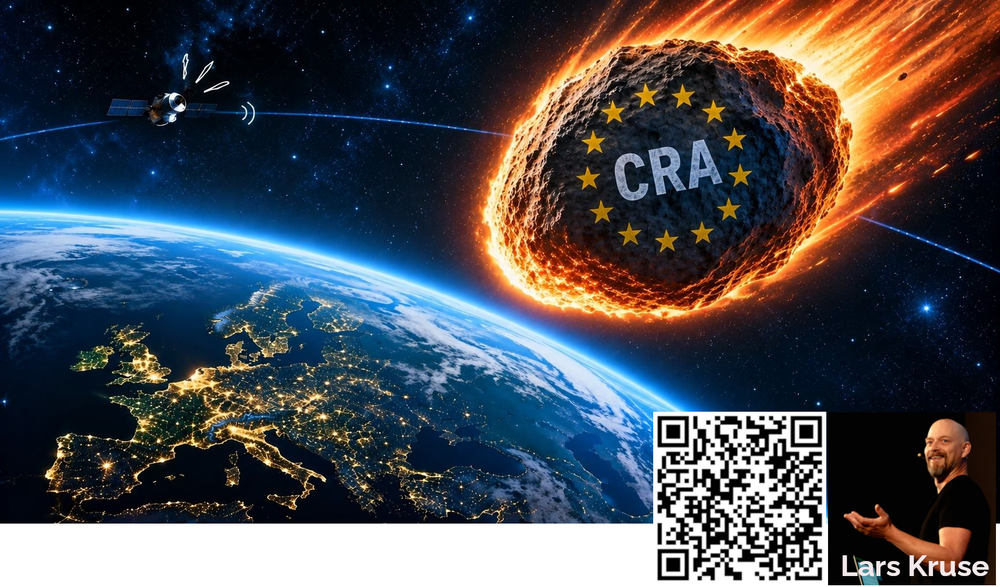
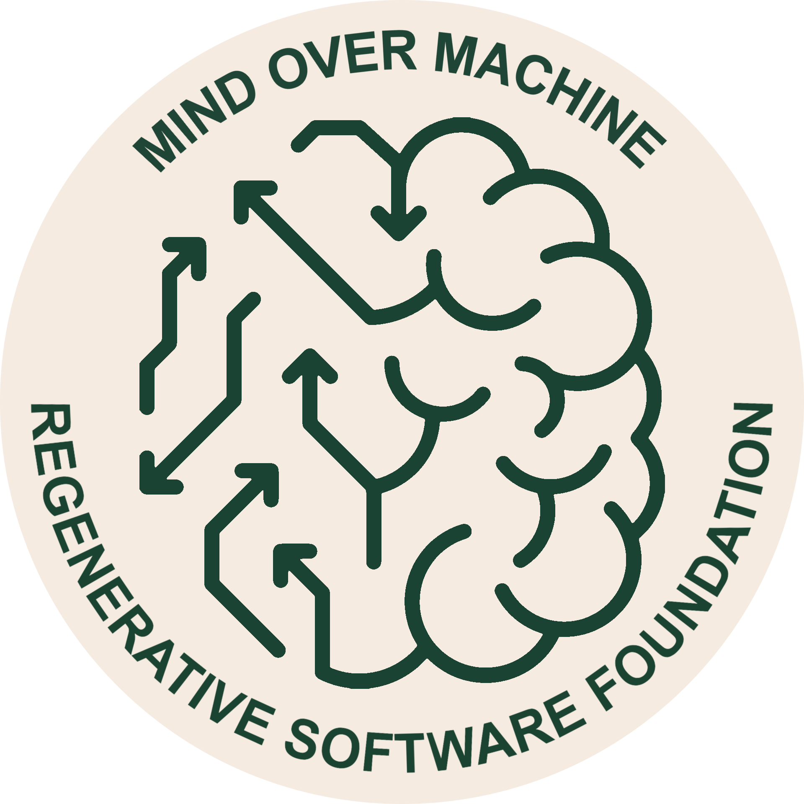
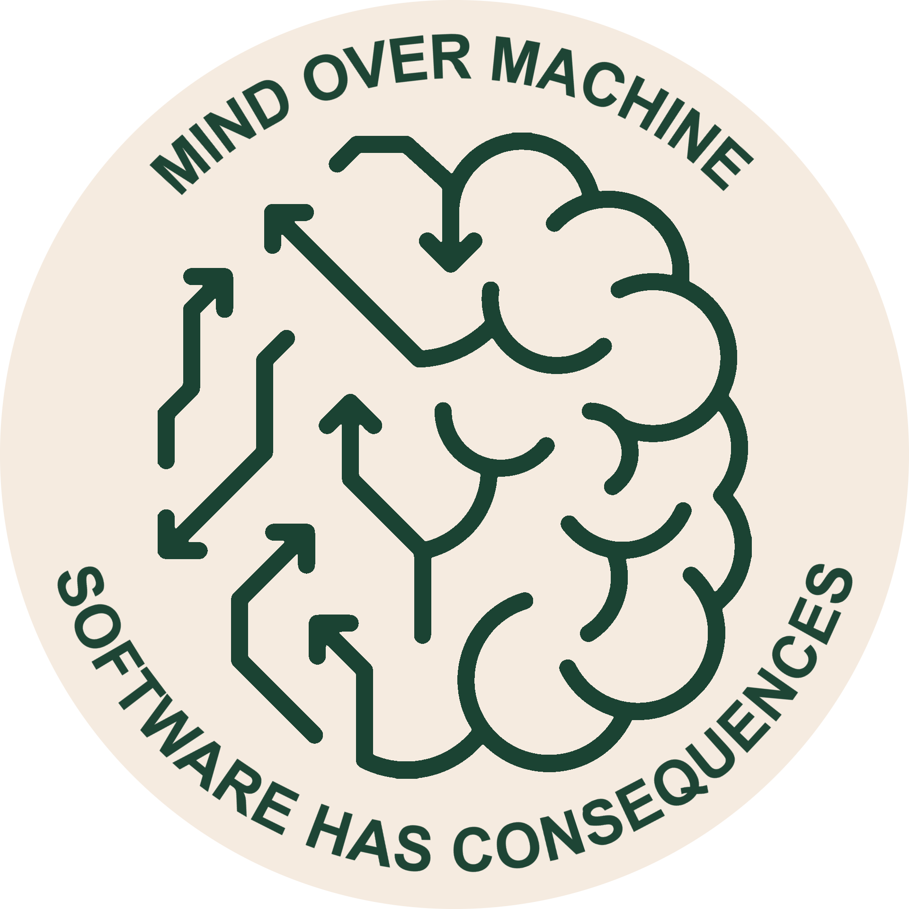
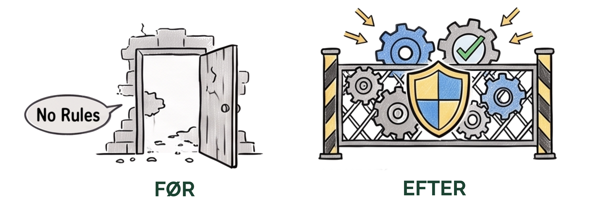
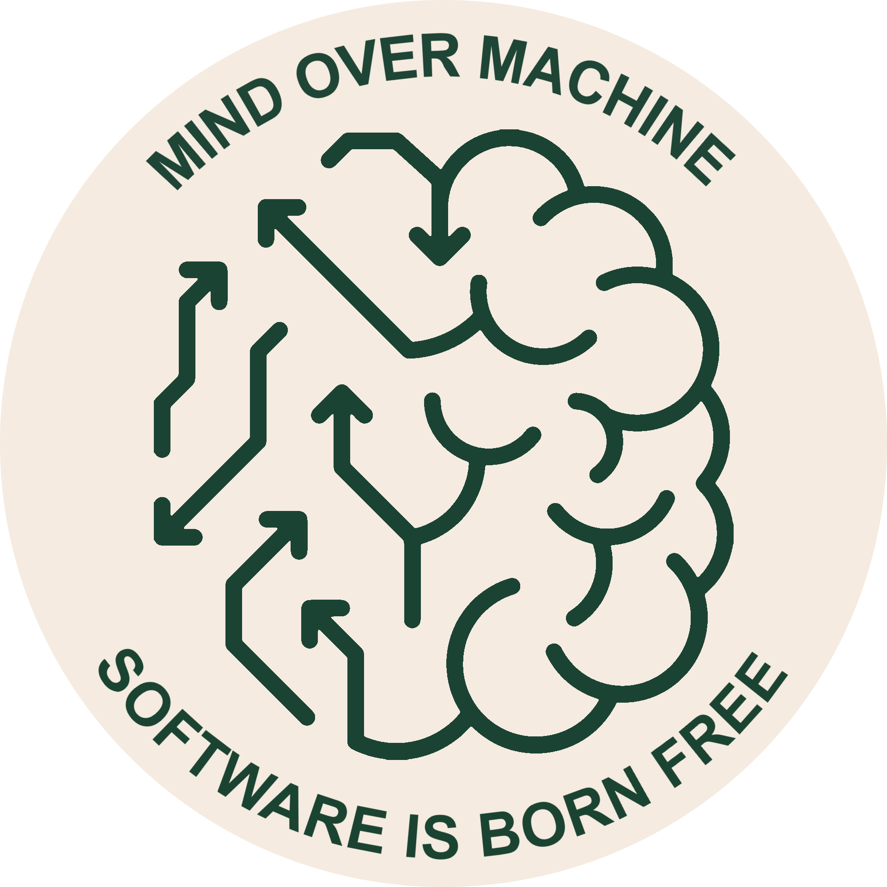
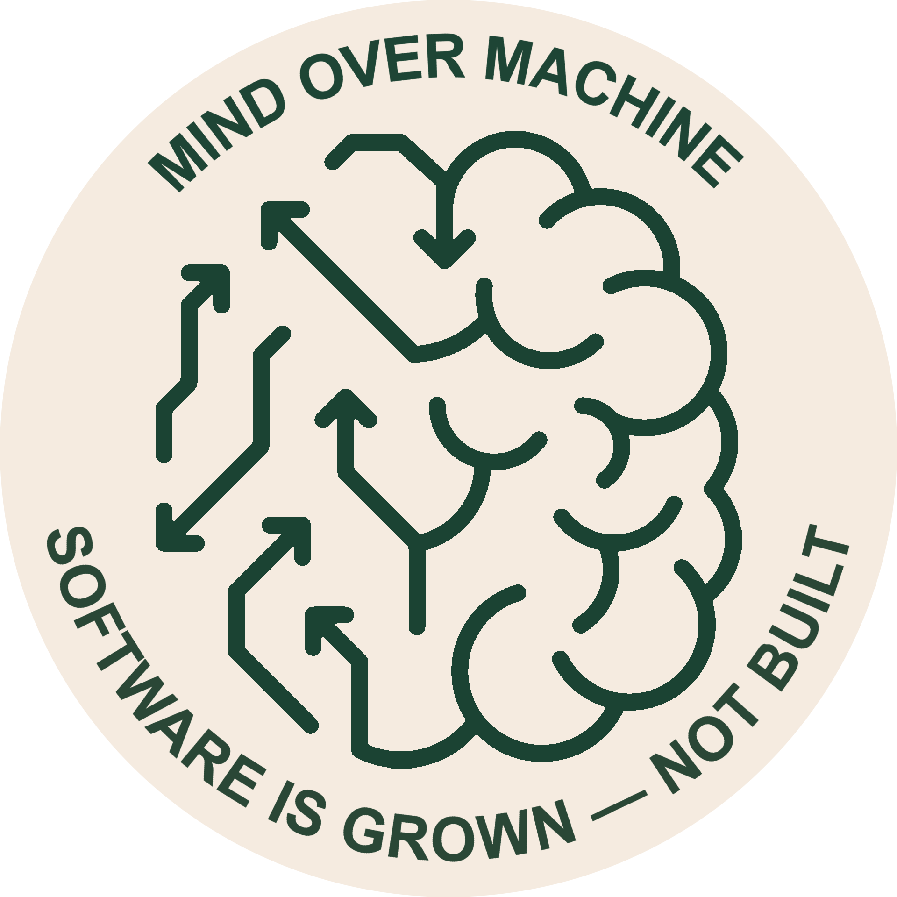
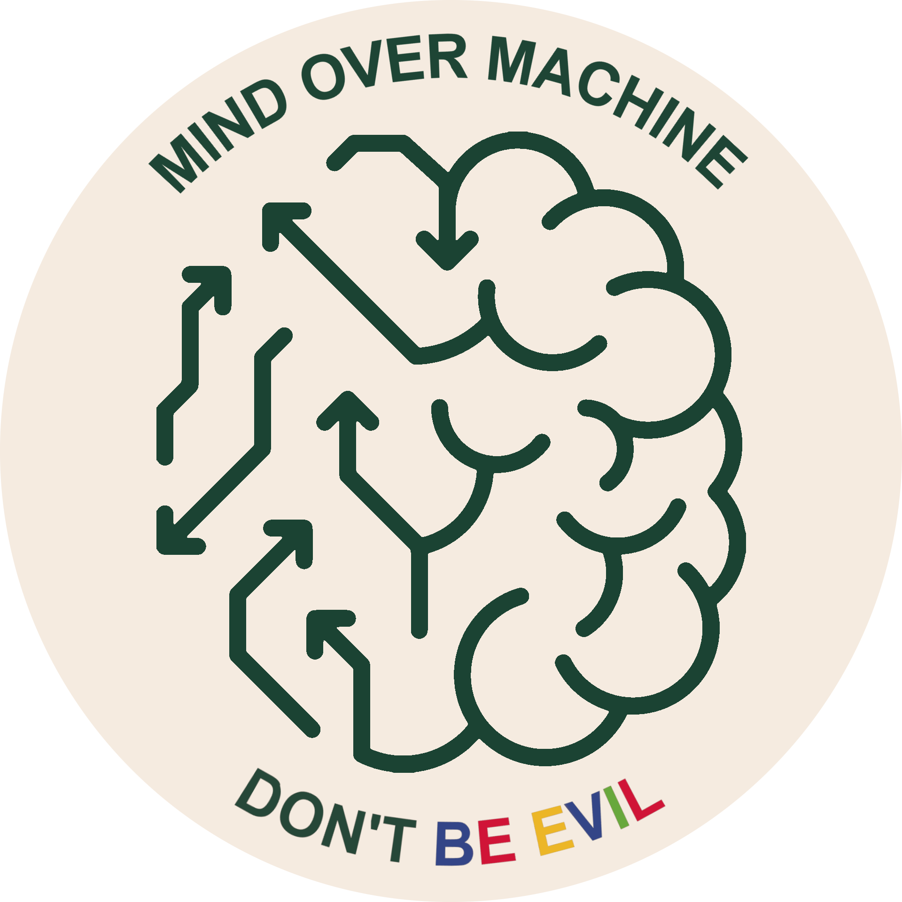
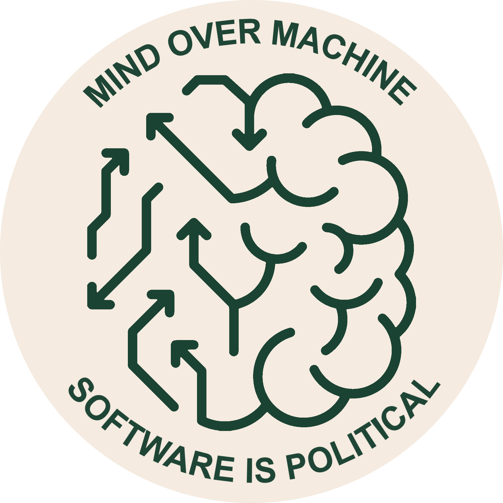
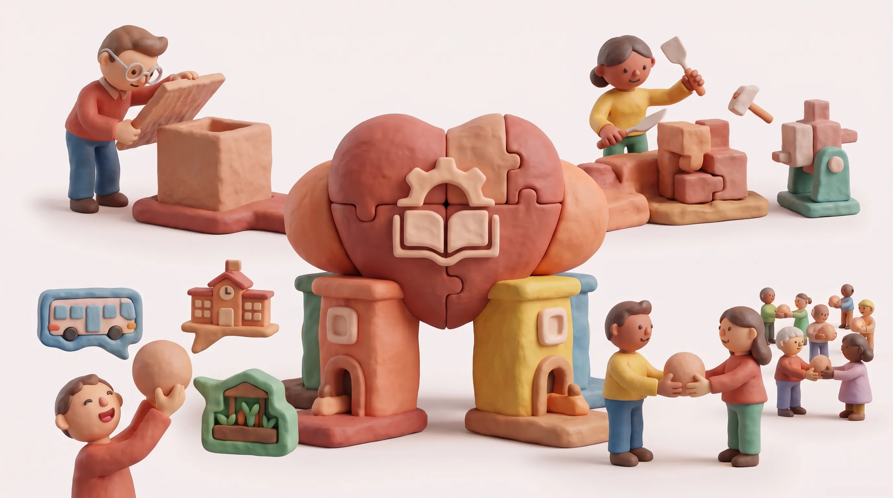
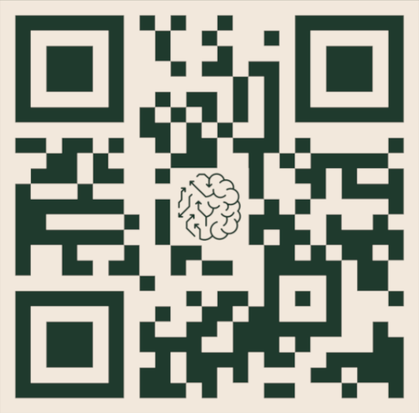

[<!-- .element style="height: 120px; margin: 0 auto 4rem auto; background: transparent;" -->](https://reveals.lakruzz.com/markdownloader/?owner=mindovermachine-dev&repo=reveals&file=mom-cra-oss-da.md/1)

Compliant with the reveal.js 
`markdownloader` 
👆 Click the logo to see it live 👆

---
---

<!-- .slide: data-background="#03050A" -->

OSS Steward Rollen under 
EU's Cyber Resilience Act

<!-- .element style="font-size: 0.8em; color:white; text-decoration:none" -->

<!-- .element style="height: 550px; margin: -50 auto 4rem auto; background: transparent; align: left;" -->

---
---

<!-- .slide: data-background="#1d4333" -->

<!-- .element style="height: 450px; margin: 0 auto 4rem auto; background: transparent; align: left;" -->

---

# Mind over Machine

Vi er en non-profit _software foundation_, som kombinerer en **tænketank**, et **laboratorium**, og et  **praksisfællesskab**. 

Vores mission er at udforske og dele regenerative tilgange og principper for softwareudvikling, så de skaber langsigtet og balanceret værdi for mennesker og for verden.

---
---

<!-- .slide: data-background="#1d4333" -->

<!-- .element style="height: 450px; margin: 0 auto 4rem auto; background: transparent; align: left;" -->

---

<!-- .slide: style="font-size: 0.85em;" -->

## Cyber Resilience Act

... er regulativ regler

<!-- .element style="height: 350px; margin: 0 auto 4rem auto; background: transparent; align: left;" -->

Note:

---

## EU's CRA

- **Målet** — Sikre fri bevægelighed af sikre produkter
<!-- .element style="font-size: 0.8em;" -->

- **Kræver** — _Secure-by-Desing_ for alle produkter med digitale elementer
<!-- .element style="font-size: 0.8em;" -->

- **Paradigm shift** — Open Source er ikke et smuthul. EU indfører juridisk ansvar
<!-- .element style="font-size: 0.8em;" -->

---
---

<!-- .slide: data-background="#1d4333" -->

<!-- .element style="height: 450px; margin: 0 auto 4rem auto; background: transparent; align: left;" -->

---

## Open Source - Tre roller

- _Hobbyists_
- _Manufactureres_
- _OSS Stewards_

---

<!-- .slide: style="font-size: 0.8em;" -->

## Det endelige ansvar ligger hos _Manufacturer_

**[Article 13](https://www.european-cyber-resilience-act.com/Cyber_Resilience_Act_Article_13.html):**

>The legal obligation to comply with the CRA falls squarely on the manufacturer

>**Manufacturere Definition:** The economic operator that places the final digital product on the EU market

---

<!-- .slide: style="font-size: 0.85em;" -->

## OSS Stewards er selvstændige juridiske enheder

**[Article 24](https://www.european-cyber-resilience-act.com/Cyber_Resilience_Act_Article_24.html)**:

>**OSS Steward Definition:** Not-for-profit legal entities that provide sustained support and infrastructure for FOSS projects

---

## OSS hobbyists er uden ansvar

> **Hack hack — Keep doing what your doing**

Hvis en _manufacturere_ bruge din kode, så bliver **_de_** ansvarlige for **_dit_** arbejde.

**I samme sekund**  du selv tager penge for din software transmogrifier du selv ind i _manufacturere_ rollen!

---
---

<!-- .slide: data-background="#1d4333" -->

<!-- .element style="height: 450px; margin: 0 auto 4rem auto; background: transparent; align: left;" -->

---

## Manufacturere responsibilities

- Technical Documentation ([Article&nbsp;31](https://www.european-cyber-resilience-act.com/Cyber_Resilience_Act_Article_31.html))
  - SBOM (Software Bill Of Materials)
  - Cybersecurity Risk Assessment
  - Test Reports & Verification Data
  - Evidence of secure-by-design
  - Architectural design
  - Vulnerability scans
- EU Declaration of Conformity ([Article&nbsp;28](https://www.european-cyber-resilience-act.com/Cyber_Resilience_Act_Article_28.html))
- CE Marking (Articles&nbsp;[29](https://www.european-cyber-resilience-act.com/Cyber_Resilience_Act_Article_29.html)&nbsp;&&nbsp;[30](https://www.european-cyber-resilience-act.com/Cyber_Resilience_Act_Article_30.html))
- Mandatory Vulnerability & Incident Reports ([Article&nbsp;14](https://www.european-cyber-resilience-act.com/Cyber_Resilience_Act_Article_14.html))

<!-- .element style="font-size: 0.8em;" -->

---

## OSS Steward responsibilities

- Verifiable Cybersecurity Policy ([Article&nbsp;24](https://www.european-cyber-resilience-act.com/Cyber_Resilience_Act_Article_24.html)(1))
- Policy Documentation for Authorities ([Article&nbsp;24](https://www.european-cyber-resilience-act.com/Cyber_Resilience_Act_Article_24.html)(2))
- Targeted Infrastructure Incident Reports ([Article&nbsp;24](https://www.european-cyber-resilience-act.com/Cyber_Resilience_Act_Article_24.html)(3) &[Article&nbsp;14](https://www.european-cyber-resilience-act.com/Cyber_Resilience_Act_Article_14.html))
- Voluntary Security Attestations ([Article&nbsp;25](https://www.european-cyber-resilience-act.com/Cyber_Resilience_Act_Article_25.html))

---

## Delt arbejde

I praksis er relationen mellem _manufacturer_ og non-profit _OSS steward_ ofte en alliance model

<!-- .element style="font-size: 0.8em;" -->

- _Manufacturers_ støtter, donerer, engagere som ressource og betaler alliance medlemskab 
- Som modydelse vil _OSS steward_ formelt kvalitetssikre og vedligeholde open-source project under Article&nbsp;[24](https://www.european-cyber-resilience-act.com/Cyber_Resilience_Act_Article_24.html)+[25](https://www.european-cyber-resilience-act.com/Cyber_Resilience_Act_Article_25.html)
- _OSS steward_ vi tage ansvar for _development pipeline_ så den producerer det output, der kræves af _Manufacturere_ så de på enkel vis kan konsumere det og være i compliance med [Article&nbsp;31](https://www.european-cyber-resilience-act.com/Cyber_Resilience_Act_Article_24.html).

<!-- .element style="font-size: 0.8em;" -->

---

## Delt ansvar

Selv om _manufacturere_ stå tilbage med det fuld ansvar kan meget af det tunge arbjede i SLDC bleve afhjulpet af personale i OSS Steward organisationen, som bliver dem der sætter kvalitetsstandarden.

<!-- .element style="font-size: 0.8em;" -->

Mest typisk vil _lead developers_ forblive de samme som før, men med den åbenlyse fordel at det kan _forblive_ lead developers — selv hvis deres ansættelse hos _manufaturere_ afsluttes.

<!-- .element style="font-size: 0.8em;" -->

---
---

<!-- .slide: data-background="#1d4333" -->

<!-- .element style="height: 450px; margin: 0 auto 4rem auto; background: transparent; align: left;" -->

---

## Smuthul?

>CRA gælder kun for produkter der installeres

💡 SaaS produkter er ikke omfattet af CRA 💪 
...indtil de _er_

---

## Smuthul?

>CRA gælder kun for produkter med digitale elementer

💡 Ikke for serviceydelser - f.eks. timebetaling 💪 
...og så alligevel

---

## Smuthul?

>OSS Steward dikterer kvaliteten

💡 Vi kan _købe_ dem til at sænke paraderne  💪 
...og stå med ansvaret selv 🤔

---

## Smuthul

>Det er ikke et krav at vi har en OSS Steward

💡 Vi kan bare gøre det selv 💪 
...CE Mærke 🤔

---

## Smuthul

>Vi er en kommune - vi sælger ikke produktet på "et marked"

💡 Så vi er ikke _manufacturere_ 💪 
...jo 🤔

---

## Smuthul

>Vi lever software til en kunde, de ejer koden

💡 Så der et _dem_ der er _manufacturere_ ikke os 💪 
...så I blive mødt med _helt_ andre krav i fremtiden

---
---

<!-- .slide: data-background="#1d4333" -->

<!-- .element style="height: 450px; margin: 0 auto 4rem auto; background: transparent; align: left;" -->

---

## Study — Use — Alter — Share

Hvis **Digital Suverænitet** er så vigtig, som tidens trend indikerer, hvad er så årsagen til at ikke flere går i retning af Open Source produkter?
<!-- .element style="font-size: 0.6em;" -->

<!-- .element style="height: 450px; margin: 0 auto 4rem auto; background: transparent; align: left;" -->

---
---

<!-- .slide: data-background="#1d4333" -->

<!-- .element style="height: 450px; margin: 0 auto 4rem auto; background: transparent; align: left;" -->

`www.mindovermachine.dk` 
`lars@mindovermachine.dk`

<!-- .element style="font-size: 0.8em; color:white; text-decoration:none" -->

